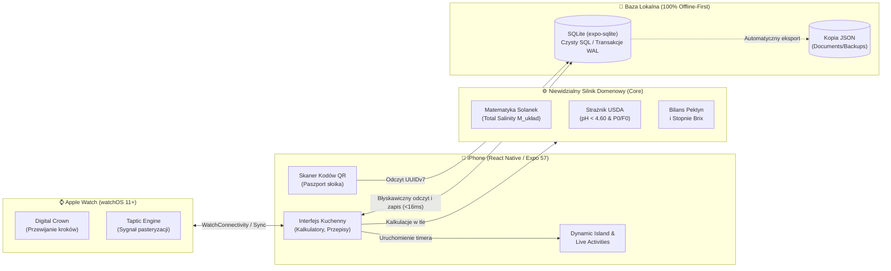

# Słoik (Jarwise) 🫙🥒🍅

[](https://www.apple.com/ios/)
[](https://www.apple.com/watchos/)
[](https://expo.dev/)
[](https://reactnative.dev/)
[](https://www.typescriptlang.org/)
[](https://sqlite.org/)
[](docs/brd/)
[](https://developer.apple.com/testflight/)

> **„Od chrupiących ogórków babci po autentyczne kimchi i pikle z całego świata — rób idealne, pyszne przetwory bez zgadywania.”**

Aplikacja mobilna na systemy iOS i watchOS dla pasjonatów domowych przetworów: kiszonek, pikli, dżemów, powideł, sosów i octów. Stworzona w bezkompromisowym standardzie rzemieślniczym ekosystemu **Apps4Brew** (na wzór projektów *Napar*, *Piekarz* i *Organizer*), w architekturze **100% Offline-First**. Łączy radość domowego rzemiosła kuchennego z laboratoryjną precyzją, która eliminuje kuchenne wpadki i gwarantuje, że każdy słoik wyjdzie idealnie chrupki, aromatyczny i bezpieczny.

---

## 🌟 Główne Zasady Produktowe (Apps4Brew)

- **100% Offline-First (SQLite w trybie WAL):** Wszystkie dane, nastawione słoiki i stany spiżarni czytane i zapisywane są bezpośrednio w lokalnej bazie SQLite (`expo-sqlite` w `src/data/db`). Aplikacja działa bez opóźnień (czas reakcji UI $< 16\,\text{ms}$) w piwnicy, na działce, w wiejskim domku i w kuchni bez zasięgu Wi-Fi.
- **Zero Login & Bez Kont:** Brak uciążliwych formularzy logowania, haseł czy ankiet marketingowych. Po zainstalowaniu od razu wybierasz przepis i zaczynasz przygotowywać słoiki.
- **Prywatność „Data Not Collected”:** Zero trackerów, zero zewnętrznych bibliotek telemetrycznych (brak Firebase, Meta, Google Analytics). Twoje receptury, stany spiżarni i notatki smakowe należą wyłącznie do Ciebie.
- **Koniec ze Zgadywaniem (Niewidzialna Nauka w Tle):** Aplikacja robi całą trudną matematykę za Ciebie. Wylicza sól w relacji do całkowitej wagi układu (warzywa + woda), dzięki czemu ogórki nigdy nie miękną. Pilnuje bezpieczeństwa mikrobiologicznego (normy USDA) i balansu pektyn w owocach, nie zarzucając Cię podręcznikowym żargonem.
- **Kuchenny Hands-Free (Apple Watch & Live Activity):** Gotowanie brudzi ręce. Dedykowana aplikacja na Apple Watch pozwala sterować asystentem i stoperem pasteryzacji za pomocą cyfrowej koronki (Digital Crown). Dynamiczna Wyspa (Dynamic Island) i Live Activities na iPhone pokazują postęp bez odblokowywania ekranu.
- **Własność Danych & Bezpieczna Persystencja:** Pełny, bezpłatny eksport i import bazy w formacie JSON w dowolnej chwili. Każdy słoik posiada unikalny identyfikator UUIDv7 powiązany z generowaną etykietą PDF i kodem QR.
- **Pojedyncze Źródło Prawdy (Single Source of Truth):** Wszystkie formuły, stałe gęstości, progi kwasowości i tabele pasteryzacji zdefiniowane są centralnie w module `src/core/constants/`.

---

## 📱 Moduły i Ekrany

1. **🥒 Asystent Nastawiania Słoików & Kalkulator Solanek (Pickle & Brine Wizard) `[STATUS: ✅ Wdrożone]`:**
   - Wpisujesz ile masz warzyw (np. 1,8 kg ogórków) i jakie masz naczynia — aplikacja w ułamku sekundy podaje: idealną wagę soli kamiennej lub morskiej, ilość wody oraz proporcje dodatków (czosnek, chrzan, koper).
   - Tryby pracy: zalewa klasyczna (ogórki, papryka), solenie na sucho (kapusta, kimchi) oraz solanki zrównoważone (*equilibrium brine*).
   - Doradca chrupkości: zaleca dodatek liści bogatych w taniny (dąb, wiśnia, chrzan) lub szczyptę chlorku wapnia ($CaCl_2$).
2. **🫧 Żywy Kalendarz Fermentacji & Dziennik Sensoryczny (Active Ferment Timeline & Log) `[STATUS: ✅ Wdrożone]`:**
   - Dynamiczna oś czasu dla każdego nastawionego słoika na blacie kuchennym z uwzględnieniem kinetyki Arrheniusa ($Q_{10}=2.0$).
   - Prowadzi przez fazy życia kiszonki: początkowe mętnienie, burzliwe bąbelkowanie, aż po stabilizację kwasową.
   - Inteligentne przypomnienia o odgazowaniu (*burping*), aby uniknąć ciśnienia w słoikach Twist-Off.
   - Dziennik sensoryczny z oceną chrupkości (1–5 gwiazdek), aromatu i testem pH lakmusowym.
3. **⏱️ Spokojna Pasteryzacja ze Stoperem Audio (Safe Canning Assistant) `[STATUS: ✅ Wdrożone]`:**
   - Prosty przewodnik i stoper pasteryzacji: garnek z wodą, piekarnik lub tyndalizacja (3x24h).
   - Przelicza czas w zależności od pojemności słoika (od 200 ml do 1 litra).
   - Strażnik bezpieczeństwa USDA AI-539: blokada kąpieli wodnej dla pH $\ge 4.60$ (bariera jadu kiełbasianego).
   - Test wieczka: instrukcja sprawdzenia zassania próżni Twist-Off / Weck.
   - Dźwiękowy dzwonek kuchenny (`expo-av`) i powiadomienie głosowe VoiceOver (`announce.ts`) po upływie czasu.
4. **🫙 Moja Spiżarnia, Etykiety Wektorowe & Skaner QR (Pantry, PDF Labels & Scanner) `[STATUS: ✅ Wdrożone]`:**
   - Przejrzysty rejestr zapasów: wiesz dokładnie ile słoików ogórków, dżemu czy kimchi czeka w piwnicy, szafce lub lodówce.
   - Generator arkuszy etykiet do druku (PDF A4) w eleganckim stylu (kółko 55 mm i prostokąt 80x50 mm) z kodem `sloik://batch/<id>`.
   - Błyskawiczne skanowanie aparatem (`expo-camera`): nakieruj obiektyw na wieczko słoika, by natychmiast otworzyć paszport partii.
   - Wygodne ubywanie zapasów: jedno stuknięcie „Otwarty / Zjedzony” aktualizuje stan spiżarni.
5. **🔔 Powiadomienia Lokalne Offline (Kitchen Push Notifications) `[STATUS: ✅ Wdrożone]`:**
   - Lokalne powiadomienia iOS/Android (`expo-notifications`) bez serwera i bez kosztów (0 PLN).
   - Przypomnienie o codziennym odgazowaniu (burp) w fazie burzliwej (dni 1–3) i alert optymalnego smaku małosolnych.
6. **🔬 Laboratorium Eksperymentów & Panel Degustacyjny (Multi-Jar Split-Batch Lab & Showdown) `[STATUS: ⏳ Zaprojektowane w BRD / Gotowe do wdrożenia]`:**
   - Nastawianie serii $N$ słoików ($N=2$ do $8$) z jednej bazy surowca z kontrolowaną matrycą różnic (zróżnicowane stężenia soli, liście dębu vs wiśni vs porzeczki, $CaCl_2$, gramatury czosnku i chili).
   - Indywidualne etykiety z kodami QR i oznaczeniem wariantów (`WARIANT A`, `WARIANT B`, `WARIANT C`...).
   - Błyskawiczne przywołanie dokładnego składu po nakierowaniu aparatu na dowolny słoik w piwnicy po miesiącach.
   - Panel ślepej degustacji (Blind Cupping) z punktacją 0–100 pkt (chrupkość, kwasowość, bukiet, wygląd) i pomiarem pH.
   - Matryca porównawcza Side-by-Side i wyłonienie zwycięzcy: jedno dotknięcie zapisuje zwycięski wariant jako stałą, autorską recepturę mistrzowską z możliwością skalowania na dowolną wagę.
7. **🩺 Słoikowy Ratownik (Jar Doctor / Troubleshooting) `[STATUS: ✅ Wdrożone]`:**
   - Wizualne drzewo decyzyjne z natychmiastową odpowiedzią na kuchenne wątpliwości:
     - *Biały nalot na powierzchni?* $\to$ Spokojnie, to bezpieczny kożuch drożdżowy (*Kahm yeast*). Zbierz łyżką, kiszonka jest zdrowa!
     - *Czosnek zzieleniał lub zrobił się niebieski?* $\to$ Naturalna reakcja enzymów w kwaśnym środowisku, w 100% jadalny.
     - *Ogórki zmiękły lub są puste w środku?* $\to$ Wyjaśnienie przyczyny (pektynaza, twardość wody) i wskazówki na przyszłość.
     - *Puchata, kolorowa pleśń ponad taflą?* $\to$ Bezwzględna zasada: wyrzuć całą zawartość słoika dla bezpieczeństwa.
8. **⚙️ Ustawienia, Kopia Zapasowa (Zero Data Loss) & Pro `[STATUS: ✅ Wdrożone]`:**
   - Bezpieczny eksport i import bazy w JSON za pomocą natywnego menu udostępniania (`expo-sharing`, `expo-file-system`, schowek).
   - Etyczny model monetyzacji: darmowy, funkcjonalny rdzeń + opcjonalny pakiet Pro (3,99 zł/mies., 19,99 zł/rok lub 59,99 zł Lifetime).
9. **⌚ Asystent Apple Watch & Hands-Free Kitchen `[STATUS: ⏳ Moduł w planach v1.1]`:**
   - Dedykowana aplikacja na watchOS z dużymi elementami dotykowymi i obsługą cyfrowej koronki (Digital Crown).

---

## 🔄 Architektura Przepływu Danych & Hands-Free Kitchen



| Mechanizm | Implementacja w kodzie | Gwarancja dla użytkownika |
|---|---|---|
| **Lokalny odczyt i zapis** | `expo-sqlite`, `src/data/db/` | Baza na telefonie; zerowe opóźnienia, brak konieczności łączenia z internetem |
| **Kuchenne Hands-Free** | Swift WatchConnectivity + LiveActivity | Wygodna praca z mokrymi dłońmi; powiadomienia na zegarku i ekranie blokady |
| **Generowanie ID słoików** | `UUIDv7` (czasowo-sortowalne) | Unikalny kod każdej partii, idealna synchronizacja z drukowanymi etykietami QR |
| **Strażnik Bezpieczeństwa** | `src/core/safety/botulinumGuard.ts` | Niemożność przypadkowego wygenerowania niebezpiecznego zalecenia pasteryzacji |
| **Kopia zapasowa** | `src/data/backup.ts` | Pełna ochrona historii przetworów, eksport bazy jednym kliknięciem do JSON |

---

## 🧪 Wzorcowe Receptury w Bazie (Master Recipes)

Aplikacja zawiera fabryczną bazę **24 zweryfikowanych receptur rzemieślniczych z całego świata**, opracowanych tak, by zawsze się udawały:

### 🥒 Klasyka Polski i Europy Środkowej
- **Ogórki małosolne chrupiące (Ekspresowe 48h):** Sekret liści chrzanu, czosnku, kopru i dębu. Gotowe w 2 dni.
- **Ogórki kiszone tradycyjne na zimę:** Klasyczna solanka zrównoważona 2.5%, powolne kwaszenie, idealna chrupkość do wiosny.
- **Kiszona kapusta z kminkiem i marchewką:** Szatkowanie, solenie na sucho (2.0%), ugniatanie do soku i harmonogram odgazowywania.
- **Zakwas buraczany na barszcz i probiotyczny napój:** Czosnek, ziele angielskie, liść laurowy i głęboki rubinowy kolor.
- **Klasyczne grzyby leśne w zalewie octowej:** Borowiki, maślaki lub podgrzybki w zbalansowanej, łagodnej marynacie octowej.
- **Aksamitne powidła śliwkowe bez mieszania:** Tradycyjna metoda wolnego prażenia śliwek węgierek bez grama cukru.

### 🥢 Azja Wschodnia (Korea & Japonia)
- **Baechu-kimchi (Klasyczne kimchi z kapusty pekińskiej):** Solenie wstępne, kleik ryżowy, pasta gochugaru, rzodkiew mu, czosnek i imbir.
- **Kkakdugi (Chrupiące kimchi z białej rzodkwi):** Kostki chrupiącego daikona w pikantno-słodkim sosie, fermentujące w 3–4 dni.
- **Oi Sobagi (Nadziewane ogórki po koreańsku):** Letnie pikle ogórkowe nacinane w kieszonki i nadziewane dymką oraz chili.
- **Japońskie Tsukemono Asazuke (Pikle ekspresowe):** Szybkie prasowanie chrupiących warzyw z wodorostem kombu (gotowe w 12h).
- **Shiozuke (Słone pikle japońskie z cytrusową nutą):** Delikatne warzywa prasowane z solą morską i skórką cytryny.

### 🌍 Bliski Wschód, Maghreb i Indie
- **Marokańskie kiszone cytryny (L'hamd Marakad):** Całe cytryny nacinane w krzyż, ciasno upchane w soli morskiej i własnym soku. Do tajine i sałatek.
- **Indyjski Mango Achar (Ogniste pikle w oleju):** Zielone mango macerowane z kozieradką, nasionami gorczycy, asafetydą i chili.
- **Kiszone rzodkiewki i kalafior w kurkumie po lewantyńsku:** Żółto-różowe, niezwykle chrupiące warzywa serwowane do falafela i shawarmy.

### 🌶️ Ameryki i Kraje Śródziemnomorskie
- **Kosher Dill Pickles (Pikle z nowojorskich delikatesów):** Amerykańska ikona — ogórki w solance z potężną dawką czosnku, kopru i kolendry.
- **Meksykański Escabeche (Jalapeño en escabeche):** Smażone jalapeño, marchew i cebula w aromatycznej zalewie octowej z oregano i kuminem.
- **Lacto Hot Sauce (Fermentowany ostry sos paprykowy):** Zacier z ostrych papryczek fermentowany 14 dni, blendowany na gładki, głęboki sos w stylu Tabasco.
- **Włoska Giardiniera:** Kolorowa mozaika chrupiącego kalafiora, marchwi, selera i papryki w zalewie octowo-oliwnej.

### 🍓 Owoce, Dżemy i Domowa Spiżarnia
- **Dżem truskawkowy o niskiej zawartości cukru:** Krótkie gotowanie, naturalna pektyna jabłkowa, zachowany naturalny aromat świeżej truskawki.
- **Czatnej z mango, imbiru i chili:** Słodko-pikantny dodatek do serów, pieczonych mięs i chlebków naan.
- **Domowy sos pomidorowy (Passata polna na zimę):** Słodkie pomidory malinowe, świeża bazylia, pasteryzacja bez sztucznych dodatków.
- **Konfitura malinowa z nutą wanilii:** Całe owoce zatopione w przejrzystym syropie owocowym.

### 🫧 Domowe Napoje i Żywe Octy
- **Musujący kwas chlebowy na pieczywie żytnim:** Naturalnie gazowany napój ze skórki chleba razowego z rodzynkami i miętą.
- **Domowy żywy ocet jabłkowy:** Cierpliwa dwufazowa fermentacja jabłek z wytworzeniem matki octowej (*Mother of Vinegar*).

---

## 🧪 9 Warstw Weryfikacji Jakości (Testing Rigor)

Zgodnie ze standardem inżynieryjnym **Apps4Brew**, aplikacja objęta jest 9 warstwami rygorystycznych testów automatycznych:

1. **100% Pokrycia Logiki Domenowej:** Bezwzględne pokrycie testami jednostkowymi dla kalkulatora soli, przeliczników pasteryzacji i balansu cukier-kwas.
2. **Macierz Krawędziowa Parametrów:** Testowanie skrajnych wartości (od słoiczka 40 ml do gąsiorka 10 l, od 0°C do 100°C).
3. **Integralność Bazy Danych SQLite:** Weryfikacja transakcji, integralności kluczy obcych (`PRAGMA foreign_keys = ON;`) oraz automatyczne odzyskiwanie z pliku WAL po nagłym restarcie.
4. **Testy Regresji i Zepsutych Danych:** Walidacja odporności na uszkodzone pliki JSON podczas importu oraz ochrona przed dublowaniem wpisów w spiżarni.
5. **Weryfikacja Migracji Schematu:** Zautomatyzowane testy przechodzenia bazy danych przez kolejne wersje migracyjne bez utraty zapisków użytkownika.
6. **Zrzuty Ekranowe i Dostępność (Snapshot/i18n):** Pełna weryfikacja tłumaczeń PL/EN, brak uciętych tekstów w trybie Dynamic Type oraz kontrast WCAG AAA.
7. **Integracja Stanu i Komponentów:** Testy cyklu życia timerów pasteryzacji i synchronizacji stanu spiżarni.
8. **E2E Maestro na iOS:** Pełne automatyczne scenariusze na symulatorze iPhone'a: od wyboru ogórków, przez odmierzenie soli, po zapis w spiżarni.
9. **Audyt Bezpieczeństwa Biologicznego:** Blokady algorytmiczne uniemożliwiające zasugerowanie niebezpiecznych parametrów pasteryzacji dla produktów podatnych na botulizm.

---

## 🛠️ Uruchomienie i Weryfikacja

Wymagane środowisko: Node.js 20+ oraz npm.

```bash
# Instalacja zależności
npm install

# Pełna weryfikacja projektu (typy, lint, testy z pokryciem, i18n)
npm run check

# Uruchomienie testów jednostkowych i integracyjnych Jest
npm test

# Szybkie testy jednostkowe tylko dla zmienionych plików
npm run test:fast

# Testy czystej logiki kalkulatorów i bezpieczeństwa
npm run test:domain

# Uruchomienie aplikacji w środowisku deweloperskim Expo
npm run start

# Uruchomienie aplikacji na symulatorze iOS
npm run ios
```

---

## 📂 Architektura Kodu

```text
kiszonki-przetwory-sloiki/
├── src/
│   ├── core/                    # Czysty TypeScript: silnik domenowy (Zero zależności od UI)
│   │   ├── brine/               # Kalkulator solanek (masa całkowita, sucho, zalewa, gęstość)
│   │   ├── safety/              # Strażnik USDA, weryfikacja pH < 4.60, kinetyka letalności P0/F0
│   │   ├── fermentation/        # Kinetyka fazowa (LAG, LOG, stacjonarna), harmonogram odgazowywania
│   │   ├── pasteurization/      # Modele pasteryzacji (woda, piekarnik, tyndalizacja, sous-vide)
│   │   ├── preserves/           # Bilans owoc-cukier-pektyna (Brix, dżemy, powidła, czatneje)
│   │   ├── doctor/              # Drzewo decyzyjne Słoikowego Ratownika (diagnoza wad i nalotów)
│   │   └── constants/           # Pojedyncze źródło prawdy: normy USDA, gęstości, stałe z i D
│   ├── data/                    # Warstwa danych i persystencja
│   │   ├── db/                  # Baza lokalna SQLite (expo-sqlite, czysty SQL, transakcje WAL)
│   │   ├── migrations/          # Wersjonowane skrypty migracyjne schematu bazy danych
│   │   ├── repositories/        # Repozytoria: PantryRepository, RecipeRepository, BatchRepository
│   │   └── backup.ts            # Eksport i import bazy do pliku JSON
│   ├── features/                # Moduły funkcjonalne interfejsu użytkownika (UI)
│   │   ├── wizard/              # Asystent nastawiania słoika krok po kroku
│   │   ├── timeline/            # Żywa oś czasu fermentacji i powiadomienia sensoryczne
│   │   ├── pasteurizer/         # Stoper pasteryzacji i test wieczka
│   │   ├── pantry/              # Cyfrowa spiżarnia, stany magazynowe i generator etykiet PDF
│   │   ├── recipes/             # Przeglądarka i detale 24 Mistrzowskich Receptur Świata
│   │   ├── doctor/              # Interaktywny Słoikowy Ratownik (pytania, zdjęcia, diagnozy)
│   │   └── settings/            # Ustawienia jednostek, kopia zapasowa, zakupy Pro StoreKit
│   ├── native/                  # Integracja z systemem iOS i watchOS
│   │   ├── watch/               # Komunikacja z Apple Watch (WatchConnectivity)
│   │   ├── live-activity/       # Dynamic Island i widgety ekranu blokady
│   │   └── siri/                # Skróty Siri i App Intents (głosowe Hands-Free)
│   ├── i18n/                    # Polskie i angielskie tłumaczenia tekstów
│   └── theme/                   # Palety barw, typografia Dynamic Type, zasady Apple HIG
├── docs/                        # Dokumentacja projektowa
│   └── brd/                     # Kompletne wydanie BRD (26 modularnych rozdziałów, >100 stron)
├── scripts/                     # Skrypty narzędziowe i weryfikacja metryk
│   ├── count_stats.py           # Narzędzie obliczania dokładnych statystyk BRD
│   └── compile_brd.py           # Kompilator wydania zbiorczego BRD
└── tests/                       # Testy automatyczne (9 warstw jakości)
    ├── unit/                    # Testy jednostkowe formuł chemicznych i solanek
    ├── integration/             # Testy bazy danych SQLite i repozytoriów
    ├── e2e/                     # Scenariusze kuchenne Maestro dla symulatora iOS
    └── guards/                  # Testy strażnicze wzorców interakcji i reguł bezpieczeństwa
```

---

## 📚 Dokumentacja i Rejestr Decyzji

- **Zasady pracy i standardy inżynieryjne:** [`CLAUDE.md`](CLAUDE.md)
- **Kompletna dokumentacja BRD (moduły):** [`docs/brd/`](docs/brd/)
- **Jedno wydanie zbiorcze BRD (Monolit):** [`docs/brd/Kiszonki_BRD_Kompletne_Wydanie.md`](docs/brd/Kiszonki_BRD_Kompletne_Wydanie.md)
- **Rejestr 60 decyzji produktowych:** [`docs/brd/Kiszonki BRD 0.1 · 00b Jedna lista decyzji i pytań (DEC-01 DEC-60).md`](docs/brd/Kiszonki%20BRD%200.1%20%C2%B7%2000b%20Jedna%20lista%20decyzji%20i%20pyta%C5%84%20(DEC-01%20DEC-60).md)
- **Errata 15 sprzeczności i mitów kulinarnych:** [`docs/brd/Kiszonki BRD 0.1 · 00c Sprzeczności i errata.md`](docs/brd/Kiszonki%20BRD%200.1%20%C2%B7%2000c%20Sprzeczno%C5%9Bci%20i%20errata%20(mikrobiologia,%20bezpiecze%C5%84stwo%20USDA,%20botulinum,%20ocet%20vs%20laktofermentacja).md)
- **Rejestr 60 ryzyk projektowych:** [`docs/brd/Kiszonki BRD 0.1 · D3 · rejestr ryzyk (RYZ-01 RYZ-60).md`](docs/brd/Kiszonki%20BRD%200.1%20%C2%B7%20D3%20%C2%B7%20rozdz.%2014,%2016%20rejestr%20ryzyk%20(RYZ-01%20RYZ-60)%20i%20otwarte%20pytania.md)
- **9 Warstw Strategii Testów (DoD):** [`docs/brd/Kiszonki BRD 0.1 · D4 · wielowarstwowa strategia testów.md`](docs/brd/Kiszonki%20BRD%200.1%20%C2%B7%20D4%20%C2%B7%20rozdz.%2017%20wielowarstwowa%20strategia%20test%C3%B3w%20(9%20warstw%20jako%C5%9Bci%20dla%20bezpiecze%C5%84stwa%20%C5%BCywno%C5%9Bci%20i%20logiki).md)

---

## 🚀 Status & Dystrybucja

- **Dystrybucja:** Wersja testowa przygotowywana pod Apple TestFlight.
- **Ekosystem:** Zoptymalizowana dla iOS 18+ oraz watchOS 11+.
- **Zasady interakcji:** 100% zgodności z Apple Human Interface Guidelines, wsparcie VoiceOver, Dynamic Type i wysoki kontrast WCAG AAA.
- **Prywatność:** Architektura 100% Offline-First — wszystkie Twoje słoiki i receptury zostają wyłącznie na Twoim urządzeniu.
